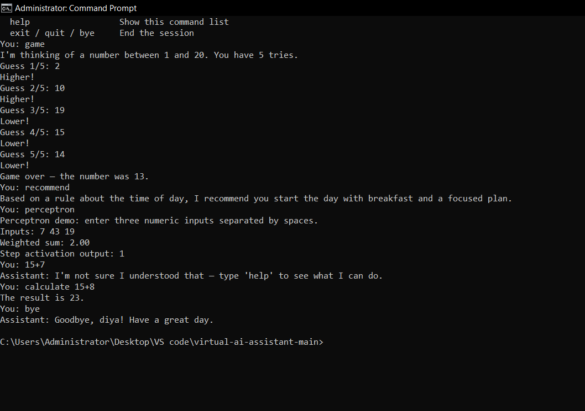

# Virtual AI Assistant (Mini Alexa)

A beginner-friendly, offline, rule-based virtual assistant built with Python's standard library. It demonstrates command classification, keyword detection, exception handling, simple recommendation rules, and a non-trained perceptron calculation.

## Features

- Greets the user and remembers their name during the session
- Reports the current date and time
- Performs addition, subtraction, multiplication, and division
- Handles invalid arithmetic and division by zero without crashing
- Returns random motivational quotes, jokes, and facts
- Provides a limited-attempt number-guessing game
- Includes a help menu and graceful exit commands
- Demonstrates rule-based activity recommendation
- Demonstrates a simplified artificial neuron/perceptron with inputs, weights, bias, and step activation
- Uses text input only and works without internet access or third-party packages

## Requirements

- Python 3.8 or newer
- No external libraries are required

## Run the assistant

Open a terminal in this project folder and run:

```bash
python main.py
```

On systems where `python` is not the command, try `py main.py` on Windows or `python3 main.py` on macOS/Linux.

At startup, enter your name. Then type `help` to see the commands.

## Example commands

```text
time
date
calculate 12 + 8
calculate 5 / 0
quote
joke
fact
game
recommend
perceptron
help
exit
```

For the perceptron demo, enter three numbers such as `1 0 1`. The program computes a weighted sum and applies a step activation that returns `0` or `1`.

## Project structure

```text
virtual-ai-assistant/
├── main.py              # Entry point, input loop, and rule-based router
├── screenshots/
│   └── assistant-demo.png
├── greetings.py         # Name capture and greeting
├── datetime_utils.py    # Date and time helpers
├── calculator.py        # Safe arithmetic parsing and calculation
├── content.py           # Offline quotes, jokes, and facts
├── game.py              # Number-guessing game
├── ai_concepts.py       # Recommendation and perceptron demonstrations
├── help_menu.py         # Supported-command help text
├── test_assistant.py    # Standard-library unit tests
└── README.md            # Setup and usage documentation
```

## AI, ML, and DL concepts

The assistant is a **rule-based AI system**: it normalizes user input and uses explicit keyword and pattern rules to select a response function. The `recommend_activity()` function is a small decision-tree-style demonstration based on the current hour.

No machine-learning model is trained. The project uses plain Python analogies to introduce ML ideas such as classification, feature-based decisions, and recommendation logic. The `perceptron()` function demonstrates a basic neural-network building block: inputs are multiplied by fixed weights, a bias is added, and a step activation returns a binary output.

### Concept-to-Code Mapping

| Concept | Implementation | Description |
|---|---|---|
| Rule-based AI | `main.py` | Uses conditions and rules to understand commands. |
| Pattern matching | `main.py` | Uses `re.findall()` to detect mathematical expressions. |
| Natural language processing (basic) | `main.py` | Converts user input to lowercase and identifies keywords. |
| Arithmetic processing | `calculator.py` | Parses and calculates mathematical expressions. |
| Recommendation system | `ai_concepts.py` | Suggests activities based on simple rules. |
| Perceptron | `ai_concepts.py` | Demonstrates inputs, weights, bias, and activation. |
| Exception handling | `calculator.py`, `game.py` | Handles invalid input and calculation errors. |
| Software testing | `test_assistant.py` | Uses unit tests to verify application features. |

## Testing

Run the automated checks with:

```bash
python -m unittest -v
```

If needed, use `py -m unittest -v` on Windows or `python3 -m unittest -v` on macOS/Linux.

The tests cover name capture, date/time formatting, arithmetic, division-by-zero handling, content selection, the guessing game, rule-based recommendations, the perceptron, routing, fallback behavior, and graceful exit.

## Limitations and future enhancements

This intentionally beginner-level application has no trained model, external API, database, GUI, persistent storage, or speech recognition. Future projects could add persistence, a graphical interface, a real dataset, or a trained classifier while keeping the same input-process-response architecture.

## Project Demo

Here is a screenshot of the Virtual AI Assistant running successfully:


